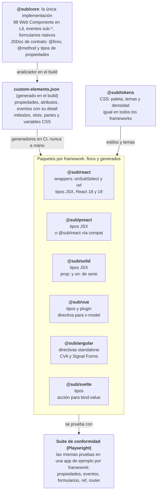

# SUB en React, Vue, Angular, Svelte, Solid y Preact

Estudio de integración · 26 de noviembre de 2026

> **Estado (27 de noviembre de 2026): solución C implementada.** Contrato en `packages/core/custom-elements.json`,
> generador en `scripts/gen-frameworks.mjs`, seis paquetes (`packages/{react,vue,angular,preact,solid,svelte}`),
> seis apps de ejemplo (`examples/`) y una suite de conformidad que pasa en los seis frameworks (30/30).
> Cambio respecto al plan: `sub-breadcrumbs` y `sub-nav-menu` no pasan a slots; **reenvían el clic** al enlace del
> autor, así un `<Link>` de cualquier framework ejecuta su manejador y el diseño compacto se conserva.
> Pendiente: SSR (fase 4) y publicar `@sub/angular` con ng-packagr.

Recomendación: no reescribir nada. Los Web Components siguen siendo la única implementación; de un manifiesto generado automáticamente (Custom Elements Manifest) salen paquetes finos por framework con tipos, eventos idiomáticos e integración con formularios y routers. Un componente nuevo llega a los seis frameworks sin escribir código por framework.

## Opciones evaluadas

Gana la C: una sola implementación y un coste por framework cercano a cero, porque las capas de cada framework se generan, no se escriben.

| Estrategia | Dónde se usa | Implementaciones que mantener | Encaje en cada framework | Riesgo | Veredicto |
| --- | --- | --- | --- | --- | --- |
| A. Reimplementar en cada framework | Headless UI, PrimeReact / PrimeVue | 6 | Total | Comportamiento y accesibilidad divergen; 6 veces los tests | Descartada |
| B. Web Components tal cual, solo tipos | React 19, Vue, Svelte, Solid y Preact ya los aceptan | 1 | Parcial: eventos como `onsub-select`, sin `v-model` ni formularios de Angular | Bajo | Base de la C, insuficiente sola |
| C. Web Components + paquetes finos generados desde el manifiesto | Shoelace (wrappers de React generados con `@lit/react`), Ionic (Stencil), wc-toolkit | 1 + generadores | Alto: `onSubSelect`, `v-model`, formularios de Angular, tipos | Medio-bajo: se genera y se prueba en CI | **Recomendada** |
| D. Reescribir en Mitosis y compilar a cada framework | Builder.io Mitosis | 1, en un lenguaje nuevo | Alto en teoría | Muy alto: reescribir 98 elementos y depender de los límites del compilador | Descartada |
| E. Núcleo headless (máquinas de estado) + vistas por framework | Zag.js + Ark UI | 1 núcleo + 6 capas de vista | Total | Muy alto: rehacer render y estilos seis veces | Descartada hoy |

La B ya funciona sin escribir nada; la C añade lo que le falta a cada framework y sale del mismo manifiesto, así que no crece con cada componente nuevo.

## Arquitectura propuesta

Los componentes se escriben una vez; todo lo que hay debajo del manifiesto se genera y se prueba en CI.

El estilo no pasa por los paquetes: `@sub/tokens` es CSS y funciona igual en los seis frameworks, igual que los temas y la densidad.

## Qué necesita cada framework

React 19, Preact, Solid, Vue y Svelte ya usan los componentes sin envoltorio; su paquete solo traduce eventos, `value` y tipos. Angular es el que más pide: directivas para sus formularios.

| Framework | Propiedades complejas (`rows`, `options`) | Eventos `sub-*` | Valor de los controles | Paquete que generamos |
| --- | --- | --- | --- | --- |
| React 19 | Como propiedad, en cliente y en SSR | Nativo como `onsub-select` (con el guion y la caja exactos); el wrapper da `onSubSelect` | `value` + `onChange` controlados | `@sub/react`: wrappers generados (wc-toolkit `react-wrappers` o `@lit/react`), `ref` tipado con los métodos, tipos JSX |
| Preact | Como propiedad si existe en el elemento | `onsub-select` | `value` + `onChange` | `@sub/preact`: tipos JSX (o `@sub/react` vía `preact/compat`) |
| Solid | `prop:rows` | `on:sub-select` | `prop:value` + `on:change` | `@sub/solid`: tipos JSX |
| Vue 3 | Como propiedad si existe en el elemento | `@sub-select` | `v-model` necesita adaptador (verificar control a control) | `@sub/vue`: tipos, plugin `isCustomElement` y directiva de `v-model` |
| Angular (sin zone.js, v21 en adelante) | `[rows]` | `(sub-select)` | Directiva con el mismo selector: `ControlValueAccessor` hoy, `FormValueControl` de Signal Forms (v22) | `@sub/angular`: directivas standalone generadas con `input()` / `output()` tipados |
| Svelte 5 | Como propiedad si existe en el elemento | `onsub-select` | `bind:value` (verificar; si no, una acción pequeña) | `@sub/svelte`: tipos y la acción si hace falta |

Los 18 controles ya son *form-associated* (`ElementInternals`): un `<form>` nativo los envía en cualquier framework, también en las acciones de React Router, SvelteKit y Next, sin adaptador.

## Lo que hay que arreglar antes en SUB

El bloqueo serio es la navegación: 6 componentes pintan sus `<a>` dentro del shadow DOM y ningún router de framework los intercepta. Lo demás es documentar bien el contrato para que el generador tenga qué leer.

| Problema | Dónde (inventario del código) | Qué rompe en los frameworks | Arreglo |
| --- | --- | --- | --- |
| Enlaces dentro del shadow DOM | `sub-button` con `href`, `sub-link`, `sub-pagination`, `sub-breadcrumbs`, `sub-nav-menu`, `sub-menu` (opciones con `href`) | `<Link>` de Next y React Router, `RouterLink` de Vue y `routerLink` de Angular no ven esos clics: cada uno recarga la página entera | Un solo punto de navegación: evento cancelable `sub-navigate` + `configure({ navigate })`; cada paquete lo conecta a su router. `sub-breadcrumbs` y `sub-nav-menu` dejan de copiar los enlaces del autor y los proyectan con slots, como ya hacen `sub-descriptions` y `sub-timeline` |
| Eventos sin tipo publicado | 31 eventos `sub-*` más `change` / `input` nativos | Sin el tipo de `detail`, ningún generador puede crear callbacks tipados | `@fires sub-select {CustomEvent<{ value: string }>}` en el JSDoc de cada componente y declaración en `HTMLElementEventMap` |
| Propiedades que no son atributos | 20 propiedades con `attribute: false` (`rows`, `columns`, `options`, `items`, `steps`…) | Ninguno, si el manifiesto las marca como propiedad; sí en HTML servidor, que solo lleva atributos | El analizador las detecta; documentar su tipo para los tipos generados |
| Métodos imperativos | ~30 métodos públicos (`toast()`, `start()`, `show()`, `expandAll()`…) | Hay que llegar a ellos con `ref` | Los wrappers reenvían `ref` con el tipo del elemento; JSDoc en cada método público |
| Hijos leídos del DOM ligero | 21 componentes (`sub-option`, `sub-tab-panel`, `sub-desc`…) | Los frameworks añaden y quitan hijos sin recargar | Resuelto: `ChildrenController` ya re-renderiza al añadir o quitar hijos directos (hay test) |
| Sin manifiesto | No hay `custom-elements.json` | Sin él no hay generadores, ni autocompletado en editores, ni documentación automática | `@custom-elements-manifest/analyzer` con su plugin de Lit en el build del core, revisado en CI |

## SSR e hidratación

Primero, componentes renderizados en el cliente sin saltos de layout; el SSR completo con shadow DOM declarativo queda para una fase posterior, porque sus integraciones siguen en Labs.

- **Hoy, en todos los frameworks:** el HTML del servidor ya lleva el contenido del DOM ligero (texto de las opciones, enlaces, etiquetas), así que se lee antes de que cargue JavaScript. Los componentes se registran al hidratar; en el App Router de Next van tras `'use client'`.
- **Sin saltos de layout:** añadir a `@sub/tokens` reglas `sub-*:not(:defined)` con el tamaño final de cada control (44 px de alto en cómodo, 32 en compacto).
- **Importar en el servidor ya es seguro:** las comprobaciones de navegador a nivel de módulo están protegidas (`typeof HTMLElement !== 'undefined'`).
- **SSR completo con Lit:** `@lit-labs/ssr` + shadow DOM declarativo (~96 % de los navegadores). Next: `@lit-labs/nextjs` solo cubre el Pages Router y sigue en 0.2.x; en el App Router, la `<template>` del shadow DOM declarativo rompe la hidratación de los Server Components. Nuxt: plugin de terceros `nuxt-ssr-lit`. SvelteKit y Angular: sin integración conocida.

## Mantenimiento a largo plazo

La regla que lo hace sostenible: los paquetes por framework no se editan a mano. Si un framework necesita algo, se cambia el componente o el generador.

- **Una fuente de verdad:** código de `@sub/core` → `custom-elements.json` (generado en cada build) → paquetes generados. CI falla si el manifiesto cambia y los paquetes no se regeneraron.
- **Versión única:** `@sub/core`, `@sub/tokens` y los seis paquetes publican la misma versión (changesets). Cambiar una propiedad, un evento o un método es un cambio de API para todos a la vez.
- **Una suite de conformidad para todos:** una app mínima por framework (Vite) monta los mismos escenarios y la misma suite de Playwright los recorre en las seis: propiedad compleja, evento tipado, `value` controlado, envío de `<form>`, método por `ref`, enlace con el router, hijos que cambian.
- **Dependencias mínimas:** cada paquete declara `@sub/core` y su framework como *peer*; en ejecución no añade nada salvo el wrapper de React.
- **Un fichero por componente también en los paquetes** (`@sub/react/button`), como el core, para que cada app cargue solo lo que usa.
- **Coste de un componente nuevo:** escribirlo en el core con su JSDoc. Los seis paquetes, sus tipos y su documentación salen solos.

## Plan por fases

Cada fase termina con una comprobación objetiva; no se pasa a la siguiente sin ella.

1. **Contrato del core.** Evento `sub-navigate` + `configure({ navigate })`; `sub-breadcrumbs` y `sub-nav-menu` con slots; JSDoc `@fires`, `@method` y tipos en los 98 elementos; `custom-elements.json` en el build. *Se pasa cuando* el manifiesto describe cada evento con su `detail` y un test garantiza que ningún componente copia enlaces del autor.
2. **Prueba de concepto con React y Vue.** Generar `@sub/react` y `@sub/vue` para cinco componentes representativos (`button`, `select`, `table`, `dialog`, `breadcrumbs`), con una app de ejemplo cada uno y la suite de conformidad. Resolver todo lo marcado "verificar". *Se pasa cuando* la suite pasa en ambos y el wrapper de React añade menos de 1 kB gzip por componente.
3. **Los seis frameworks, todos los componentes.** Preact, Solid y Svelte (tipos), Angular (directivas y Signal Forms). *Se pasa cuando* las seis apps pasan la suite en CI.
4. **Sin saltos de layout y prueba de SSR.** Reglas `:not(:defined)`; `@lit-labs/ssr` probado en Next (Pages Router) y Nuxt. *Se pasa cuando* el CLS es 0 en las apps de ejemplo y queda decidido si el SSR completo entra.
5. **Publicación.** El panel *Code* del playground muestra cada demo en los seis frameworks; changesets y versión conjunta.

## Decisiones abiertas

Cinco preguntas cambian el alcance; cada una lleva una propuesta.

- [ ] **Versiones mínimas.** Propuesta: React 18 y 19 (18 solo con wrapper), Vue 3.4+, Angular 20+ sin zone.js, Svelte 5, Solid 1.9, Preact 10.
- [ ] **Generador propio o de terceros.** Propuesta: wc-toolkit para React y los tipos JSX (mantienen el formato del manifiesto); un generador propio pequeño para Vue, Angular y Svelte si no hay uno maduro.
- [ ] **Nombres de eventos.** Propuesta: mantener `sub-select` (kebab-case con prefijo, el estándar de hecho y sin colisiones); los wrappers lo exponen como `onSubSelect`.
- [ ] **¿El SSR completo es requisito?** Si lo es, la fase 4 sube por delante de la 3.
- [ ] **Dónde viven los paquetes.** Propuesta: en este mismo monorepo (pnpm workspace), generados en el build.

## Fuentes

Búsquedas del 26 de noviembre de 2026; el inventario de SUB sale del código de `packages/core`. Las afirmaciones marcadas "verificar" no las cubren estas fuentes.

- React 19 y custom elements: [React DOM components](https://it.react.dev/reference/react-dom/components), [React 19 and Web Component Examples](https://frontendmasters.com/blog/react-19-and-web-component-examples/), [issue #29659](https://github.com/facebook/react/issues/29659)
- Wrappers de React: [Lit para React](https://lit.dev/docs/frameworks/react/), [wc-toolkit react-wrappers](https://github.com/wc-toolkit/react-wrappers), [Shoelace React](https://www.npmjs.com/package/%40shoelace-style%2Freact-wrapper)
- Manifiesto: [analizador y plugins](https://custom-elements-manifest.open-wc.org/analyzer/plugins/intro), [WC Toolkit](https://github.com/wc-toolkit), [Custom Elements Manifest killer feature](https://daverupert.com/2025/10/custom-elements-manifest-killer-feature/)
- SSR: [Lit SSR](https://lit.dev/docs/ssr/overview/), [@lit-labs/nextjs](https://www.npmjs.com/package/@lit-labs/nextjs), [SSR con Web Components (Ionic)](https://ionic.io/blog/the-quest-for-ssr-with-web-components-a-stencil-developers-journey)
- Angular: [Web Components en formularios de Angular](https://coryrylan.com/blog/using-web-components-in-angular-forms), [Signal Forms y FormValueControl](https://medium.com/@vetriselvan_11/angular-signal-forms-replacing-controlvalueaccessor-with-formvaluecontrol-3329f6272c8f), [Angular sin zone.js](https://www.syncfusion.com/blogs/post/angular-zoneless-change-detection)
